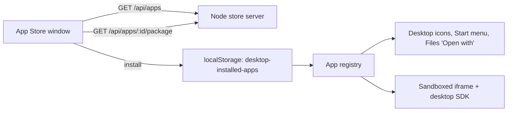

# Windows-Style Desktop (React + Vite)

A web-based Windows-style desktop built with React and TypeScript. It renders a draggable, resizable window manager with desktop icons, context menus, a taskbar, theming, and a small set of desktop apps.

Included apps:
- Browser: simple in-window web browser with address bar, navigation controls, and project quick links.
- Notes: rich text editor with menu commands and file open/save actions.
- Music: local audio player with Explorer "open with" support for tracks in `public/`.
- Photos: image viewer for files opened from Explorer.
- Files: Explorer-style file browser with folders and app-aware file opening.
- Terminal: resume/portfolio quick facts in a terminal UI.
- PDF viewer: in-window PDF reader with zoom controls.

## Live Demo
- [desktop.yamanalkhashashneh.online](https://desktop.yamanalkhashashneh.online/)

## Project Structure

- `src/App.tsx`: bootstraps the desktop with the registered apps.
- `src/apps`: each app lives in its own folder with a `Component.tsx` and an `index.tsx` that exports a `DesktopApp`.
- `src/desktop`: desktop shell (icons, context menu, taskbar, window chrome, window store).
- `src/components`: shared UI primitives (Radix UI wrappers) and the Lexical editor used by the Notes app.
- `public/audio` and `public/music`: static audio assets used by the Music app.
- `public/pdfs`: static PDF assets used by the PDF viewer.

## Running the project

```bash
npm install
npm run dev           # local dev server
npm run store:server  # App Store backend on http://127.0.0.1:4000 (run alongside dev)
npm run build         # production build
npm run preview       # serve the build output
```

## App Store

The desktop includes an **App Store** that installs apps from a small Node backend in `server/`. Installed apps work like built-in ones: they get a desktop icon, appear in the Start menu, open in windows, and can open files from Files.

### How it fits together



- **Installing downloads the whole app.** The package (manifest, HTML, icon) is saved in the browser, so installed apps keep working when the store server is offline. The server only serves the catalog and install counts.
- **Apps are isolated.** Each runs in an iframe with `sandbox="allow-scripts"` (opaque origin, no access to the desktop's storage) and a Content-Security-Policy that blocks all network access. Apps talk to the desktop only through the SDK below.
- **Uninstalling cleans up:** open windows, the desktop icon position, file-type defaults pointing at the app, and its saved data.

### Opening files and default apps

Apps declare the file types they open in their manifest (`"fileTypes": ["notes"]`). In Files, right-click a file:

- **Open with** lists every installed app that can open it.
- **Default app for .md** (or the file's extension) picks the app used on double-click. The choice is stored per file type in `localStorage` (`desktop-file-defaults`). If the chosen app is uninstalled, the built-in app is used again.

### Adding an app to the store (no desktop code changes)

Create a folder in `server/apps/<id>/` with three files and restart the server:

- `manifest.json`:
  ```json
  {
    "id": "my-app",
    "name": "My App",
    "version": "1.0.0",
    "author": "You",
    "description": "What it does.",
    "category": "Utilities",
    "fileTypes": [],
    "minSize": { "width": 400, "height": 300 }
  }
  ```
  The `id` must match the folder name. `fileTypes` can include `notes`, `pdf`, `image`, `audio`, `archive` or `binary`.
- `index.html`: a single self-contained page (inline CSS and JS). Put `<!-- desktop-sdk -->` in the `<head>` where the SDK should be injected.
- `icon.svg`: the app icon.

Invalid apps are skipped with a warning, so one bad folder can't take the store down. Bump `version` to offer an **Update** button to users who already installed the app.

### Desktop SDK

Injected into every app as `window.desktop`:

| Call | Purpose |
| --- | --- |
| `desktop.onInit(fn)` | Receives `{ windowId, file, state, theme }`. `file` is `{ name, type, text }` for notes (Markdown) or `{ name, type, url }` for other files. `state` is what the app last saved for this window. |
| `desktop.onThemeChange(fn)` | Called with `"light"` or `"dark"`. The SDK also sets `data-theme` on `<html>`. |
| `desktop.setTitle(text)` | Changes the window title. |
| `desktop.saveState(value)` | Persists JSON-serialisable state for this window (up to about 1 MB). |
| `desktop.download(name, content, mimeType)` | Saves a text file to the user's computer. |

The example apps are **Markdown Pad** (an alternative Notes opener), **Calculator** and **Focus Timer**.

### Store API

| Method | Path | Purpose |
| --- | --- | --- |
| GET | `/api/health` | Liveness check |
| GET | `/api/apps` | Catalog listing |
| GET | `/api/apps/:id` | One catalog entry |
| GET | `/api/apps/:id/icon.svg` | App icon |
| GET | `/api/apps/:id/package` | Manifest, HTML and icon for installing |
| POST | `/api/apps/:id/installs` | Record an install (counts saved to `server/data/installs.json`) |

Configuration: `STORE_PORT` (default `4000`), `STORE_HOST` (default `127.0.0.1`) and `STORE_ALLOWED_ORIGIN` (default `*`) on the server; `VITE_STORE_API_URL` on the desktop if the server runs elsewhere.

## Unit Testing

Pure logic (window store, docking math, icon grid placement, Notes serialization) is covered by Vitest tests in `tests/unit`:

```bash
npm run test:unit
```

## End-to-End Testing

The Playwright suite reads the window store through `window.__windowsManagerStore`, which is exposed in dev builds. To run it against a production build, build with `VITE_EXPOSE_TEST_HOOKS=true` and point `APP_URL` at the preview server.

Playwright tests now live under `tests/playwright` and are written in TypeScript.

- `playwright.config.ts`: shared Playwright config, including the local Vite web server.
- `tests/playwright/run.ts`: typed test orchestrator. Use this instead of creating one npm script per test.
- `tests/playwright/registry.ts`: central registry of implemented and planned tests.
- `tests/playwright/helpers`: shared Playwright helpers for opening apps and interacting with windows.
- `tests/playwright/specs`: the actual test specs.

### Run tests

List every registered test:

```bash
npm run test:e2e -- --list
```

Run a single implemented test by name:

```bash
npm run test:e2e -- --test window.drag
```

The test id can also be passed positionally:

```bash
npm run test:e2e -- window.drag
```

Run all implemented Playwright tests:

```bash
npm run test:e2e -- --all
```

### Browser dependencies

Playwright needs its browser runtime dependencies installed on the host machine. On Linux/WSL, if Chromium fails to launch with an error such as `libnspr4.so: cannot open shared object file`, install the Playwright browser dependencies before running the suite.

Typical setup:

```bash
npx playwright install
npx playwright install-deps chromium
```

## Test Plan

Use `tests/playwright/registry.ts` as the source of truth for what should be verified after each feature is implemented. Current coverage plan:

| Test ID | Feature | Status | Purpose |
| --- | --- | --- | --- |
| `window.drag` | Window manager | Implemented | Drag windows by the title bar. |
| `window.minimize` | Window manager | Planned | Minimize windows to the taskbar. |
| `window.maximize` | Window manager | Planned | Maximize and restore windows. |
| `window.dock.left` | Window manager | Planned | Snap windows to the left edge. |
| `window.dock.right` | Window manager | Planned | Snap windows to the right edge. |
| `window.close` | Window manager | Planned | Close windows and remove taskbar entries. |
| `desktop.icon.open` | Desktop | Planned | Open apps from desktop icons. |
| `desktop.icon.drag.single` | Desktop | Planned | Drag a single desktop icon. |
| `desktop.icon.drag.group` | Desktop | Planned | Drag multiple selected desktop icons together. |
| `desktop.icon.selection.marquee` | Desktop | Planned | Select icons with a marquee. |
| `desktop.context.personalization` | Desktop | Planned | Open Personalization from the desktop context menu. |
| `taskbar.window.toggle` | Taskbar | Planned | Restore and focus windows from the taskbar. |
| `notes.editor.clear` | Notes | Planned | Clear the current note from the menubar. |
| `notes.file.open` | Notes | Planned | Open a note file into the editor. |
| `notes.file.save-markdown` | Notes | Planned | Save note content as markdown. |
| `notes.format.shortcuts` | Notes | Planned | Apply formatting commands from the menubar. |
| `files.folder.navigate` | Files | Planned | Navigate folders in Explorer. |
| `files.open.notes` | Files | Planned | Open a note file from Explorer. |
| `files.open.pdf` | Files | Planned | Open a PDF file from Explorer. |
| `files.open.image` | Files | Planned | Open an image file from Explorer. |
| `files.open.audio` | Files | Planned | Open an audio file from Explorer into Music. |
| `pdf.open` | PDF viewer | Planned | Render the sample PDF. |
| `pdf.zoom` | PDF viewer | Planned | Zoom the PDF via menu commands. |
| `photos.empty-state` | Photos | Planned | Show the empty-state view with no image selected. |
| `photos.file-open` | Photos | Planned | Render an image opened from Explorer. |
| `music.file-open` | Music | Planned | Open a track from Explorer and start playback automatically. |
| `browser.navigation` | Browser | Planned | Navigate with the address bar and toolbar controls. |
| `terminal.help` | Terminal | Planned | Show the supported terminal commands. |
| `terminal.echo` | Terminal | Planned | Echo custom terminal input. |
| `personalization.theme.change` | Personalization | Planned | Change the active desktop theme. |
| `personalization.background.change` | Personalization | Planned | Change the desktop background. |
| `personalization.background.custom` | Personalization | Planned | Add and select a custom background. |

## Adding a new desktop app (step-by-step)

1) Create your app UI: add `src/apps/<your-app>/Component.tsx` with your React component.
2) Define the app metadata: add `src/apps/<your-app>/index.tsx` exporting a `DesktopApp` object (`id`, `title`, `icon`, `Component`, optional `menubar`). Example:
```tsx
// src/apps/calculator/index.tsx
import { Calculator } from "lucide-react";
import type { DesktopApp } from "../types";
import CalculatorComponent from "./Component";

export const CalculatorApp: DesktopApp = {
  id: "calculator",
  title: "Calculator",
  icon: Calculator,
  Component: CalculatorComponent,
  menubar: [
    { label: "Edit", items: [{ label: "Clear", shortcut: "Esc", onSelect: () => {/* ... */} }] },
  ],
};
```
3) Register the app so it appears on the desktop: add your export to `desktopApps` in `src/apps/index.ts`.
```ts
import { CalculatorApp } from "./calculator";
export const desktopApps = [CalculatorApp /*, ...others */];
```
4) Optional behaviors:
   - Menus: `WindowMenubar` reads `menubar` items; use `type: "separator"` or nested submenus.
   - Window actions: dispatch custom events (like the Notes/PDF apps) or keep all logic inside your component.
   - Assets: place static files in `public` (they’re served at the root).

Icons are positioned with `localStorage` (`desktop-icon-positions`); new apps get a default position, and the desktop context menu can reflow/sort them.

## Current app behavior

- Apps can be launched from desktop icons (double-click, Enter, or a tap on touch screens) or from the Start menu in the taskbar.
- Minimized windows stay mounted, so app state survives and Music keeps playing.
- "Remove from desktop" hides an icon; the choice persists in `localStorage` (`desktop-hidden-icons`) and the desktop context menu offers **Restore removed icons**.
- Notes opened from Files keep their edits: saved changes take priority over the original file content.
- Each window's content is wrapped in an error boundary, so a crashing app does not take down the desktop.
- Browser opens project shortcuts for `https://donoud.pages.dev` and `https://yamanalkhashashneh.online`, and supports manual URL entry.
- Files only lists folders and files that can actually be opened by one of the registered apps.
- Music supports opening audio files from Files via app file capabilities and starts playback automatically when a track is launched from Explorer.
- Music uses theme-based gradient styling so the header matches the currently applied desktop theme.
- Personalization supports theme selection, light/dark mode, built-in backgrounds, and custom background URLs.

## Personalization & Themes

- Open the desktop context menu (right click) and choose **Personalization** to switch themes and toggle light/dark mode. A dedicated window opens with a list of themes and a light/dark switch.
- Theme state persists in `localStorage` (`desktop-theme`) and is applied to `document.documentElement` via `src/desktop/stores/ThemeStore.ts`.
- Themes are defined in `src/desktop/themes.ts` as plain objects: `id`, `name`, `description`, `swatch`, and optional `css` (raw CSS that sets your custom variables).

### Adding a new theme
1) Create a theme entry in `src/desktop/themes.ts`:
```ts
{
  id: "my-theme",
  name: "My Theme",
  description: "Short description",
  swatch: {
    background: "#f5f5f5",
    foreground: "#1a1a1a",
    primary: "#4f46e5",
    accent: "#22d3ee", // optional
  },
  css: `
:root {
  --background: #f5f5f5;
  --foreground: #1a1a1a;
  --primary: #4f46e5;
  --accent: #22d3ee;
  /* add the rest of your variables here */
}
.dark {
  --background: #0f172a;
  --foreground: #e2e8f0;
  --primary: #a855f7;
  --accent: #22d3ee;
  /* dark overrides */
}
  `,
}
```
2) Save; the theme automatically appears in the Personalization window. Selecting it injects the `css` into a `<style>` tag and toggles light/dark via the `ThemeStore`.

## Tech Stack

- React 19 + TypeScript
- Vite (rolldown build) with React Compiler
- Tailwind CSS v4 + class-variance-authority + tailwind-merge + clsx
- Radix UI primitives (context menu, menubar, tooltip)
- Zustand + Immer for window state management
- lucide-react icons
- Lexical + shadcn-editor for the Notes rich text editor
- react-pdf + pdfjs-dist for PDF rendering
- react-terminal for the terminal app
- Framer Motion for window and dock animations
- ESLint 9 (React/TypeScript configs)
